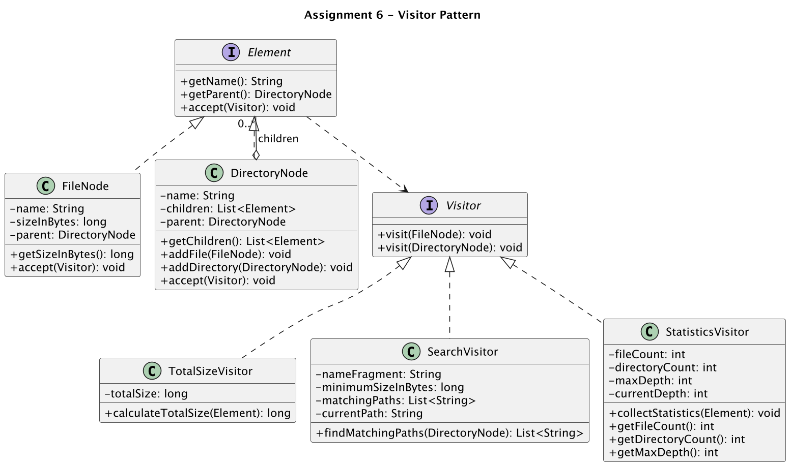

# Assignment 6 — Visitor Pattern

| | |
|---|---|
| **Student** | Anarov Daniyal |
| **Group** | SE-2530 |
| **Course** | ShP-2216 — Software Design Patterns |
| **Repository** | https://github.com/Collector119/asik-aitu-sdp6 |

## 1. Purpose and design choices

I built an in-memory file system with two element types, `FileNode` and `DirectoryNode`, and three
operations over it as separate visitors: `TotalSizeVisitor`, `SearchVisitor` and
`StatisticsVisitor`. The element classes only store data and keep the tree valid. Everything that
is calculated from the tree lives in the visitors.

| Requirement | Where it is implemented |
|---|---|
| R1 Object model | `Element`, `FileNode`, `DirectoryNode` |
| R2 Double dispatch | `accept(Visitor)` in both elements, `Visitor.visit(FileNode)` / `visit(DirectoryNode)` |
| R3 Size visitor | `TotalSizeVisitor.calculateTotalSize(Element)` |
| R4 Search visitor | `SearchVisitor(nameFragment, minimumSizeInBytes).findMatchingPaths(DirectoryNode)` |
| R5 Statistics visitor | `StatisticsVisitor.collectStatistics(Element)` and three getters |
| R6 Tree integrity | `FileNode` constructor, `DirectoryNode.checkCanBeAdded(...)`, `TreeIntegrityException` |
| R7 Traversal | `visit(DirectoryNode)` of every visitor |
| R8 Extensibility | commit "add the statistics visitor" changes no element class |

**Double dispatch.** `root.accept(visitor)` is the first dispatch: Java picks `FileNode.accept` or
`DirectoryNode.accept` by the real type of the element. Inside, the element calls
`visitor.visit(this)`. This is the second dispatch: Java picks the visitor class by its real type,
and because `this` has the type `FileNode` or `DirectoryNode`, the matching overload is chosen.
No `instanceof`, `getClass()` or casts are used anywhere in the code.

**Traversal owner: the visitors.** Each visitor walks the tree in its own `visit(DirectoryNode)`:
it loops over `getChildren()` and calls `child.accept(this)`. I chose this because the search and
the statistics need to know where they are in the tree (the current path and the current depth),
and the visitor can keep this as a field. Each child is in exactly one directory and cycles are
impossible, so every node is visited exactly once. An empty directory simply has no children.

**Paths and depth.** `SearchVisitor` keeps `currentPath`. The root has the path `""`, and a child
gets `joinPath(directoryPath, childName)`, which adds `/` only when the directory path is not empty.
So paths never contain the root name, for example `sdp/assignment6/Main.java`. The result list is
sorted with `Collections.sort`, which is lexicographic order of `String`. `StatisticsVisitor` keeps
`currentDepth`: the root has depth 0, the depth grows by one before the children of a directory are
visited and goes back after them. `maxDepth` is the largest depth of any visited node.

**State.** Each visitor has one entry method (`calculateTotalSize`, `findMatchingPaths`,
`collectStatistics`) that first resets all fields and then calls `root.accept(this)`. Because of
this, one visitor instance can be reused many times and the result never depends on earlier runs.

**Tree integrity.** A negative size is rejected in the `FileNode` constructor. `addFile` and
`addDirectory` both call `checkCanBeAdded`, which rejects a cycle (the new child is this directory
or one of its parents), a child that already has a parent, and a name that is already used by a
sibling. Every rejection throws `TreeIntegrityException` before the tree is changed.
`getChildren()` returns `Collections.unmodifiableList`, so the list can only be changed through
these two methods.

## 2. UML class diagram



## 3. Clean Code

1. **Meaningful naming.** `findMatchingPaths`, `calculateTotalSize`, `checkDoesNotCreateCycle`,
   `sizeInBytes` — the name says what the method returns or checks, so the code reads without comments.
2. **Single Responsibility.** `DirectoryNode` only stores children and protects the tree rules, while
   each calculation is in its own visitor class, so a change in the search never touches the size code.
3. **Small methods.** `checkCanBeAdded` is three calls: `checkDoesNotCreateCycle`, `checkHasNoParent`,
   `checkNameIsFree`, so each rule can be read and tested on its own.
4. **Encapsulation.** `getChildren()` returns a read-only list and `setParent` is package-private, so
   the only way to change the tree is `addFile` / `addDirectory`, which always check the rules.
5. **No type-checking chains.** `visit(FileNode)` and `visit(DirectoryNode)` replace
   `if (element instanceof FileNode) ... else ...`; the element itself chooses the right method in `accept`.

## 4. Sample output

The demo in `Main` builds its own tree (`university` with the folders `sdp`, `sdp/assignment6`,
`photos` and the empty folder `drafts`). Output of `java -cp target/classes filesystem.Main`:

```
=== 1. Total size ===
university: 8824570 bytes
sdp: 2404570 bytes
drafts: 0 bytes

=== 2. Search: name contains ".java" and size >= 400 bytes ===
from university: [sdp/assignment6/Main.java, sdp/assignment6/Visitor.java]
from sdp: [assignment6/Main.java, assignment6/Visitor.java]
from drafts: []

=== 3. Statistics ===
university: files 8, directories 5, max depth 3
drafts: files 0, directories 1, max depth 0

=== 4. Invalid changes ===
rejected: cannot add notes.txt to sdp: the name is already taken
rejected: cannot add university to assignment6: it would create a cycle
```

## 5. Tests

Test classes: `ElementTest` (7 tests), `TotalSizeVisitorTest` (3), `SearchVisitorTest` (6),
`StatisticsVisitorTest` (4). They use their own tree from `TestTree` (5 files, 5 directories,
52 400 bytes, maximum depth 3).

| Check | Tests |
|---|---|
| T1 dispatch | `ElementTest.eachElementCallsItsOwnVisitMethod` |
| T2 size | `TotalSizeVisitorTest.sizeIsSummedOverAllNestingLevels` |
| T3 both filters | `SearchVisitorTest.bothConditionsMustMatch`, `minimumSizeIsInclusive` |
| T4 paths | `SearchVisitorTest.pathsAreRelativeToRootAndSorted`, `pathsStartFromTheChosenRoot` |
| T5 statistics | `StatisticsVisitorTest.countsAndDepthAreCorrectForNestedTree`, `singleFileHasDepthZero` |
| T6 empty / no match | `emptyDirectoryHasZeroSize`, `noMatchAndEmptyDirectoryGiveEmptyList`, `emptyDirectoryCountsItself` |
| T7 repeated runs | `repeatedRunsDoNotAddUp` (size, statistics), `repeatedRunsDoNotKeepOldResults` (search) |
| T8 invalid changes | `ElementTest`: negative size, duplicate name, two parents, cycles, read-only children, valid nesting |

Result of `mvn test`:

```
Tests run: 3, Failures: 0, Errors: 0, Skipped: 0 -- in filesystem.TotalSizeVisitorTest
Tests run: 7, Failures: 0, Errors: 0, Skipped: 0 -- in filesystem.ElementTest
Tests run: 6, Failures: 0, Errors: 0, Skipped: 0 -- in filesystem.SearchVisitorTest
Tests run: 4, Failures: 0, Errors: 0, Skipped: 0 -- in filesystem.StatisticsVisitorTest
Tests run: 20, Failures: 0, Errors: 0, Skipped: 0
BUILD SUCCESS
```

## 6. Trade-offs

**Traversal.** Because the visitors own the traversal, the loop over children is repeated in each
`visit(DirectoryNode)`. The benefit is that each visitor controls its own path and depth state in
one place. With a separate walker the loop would exist once, but the walker would have to pass the
path and the depth to the visitors, and the `Visitor` interface would become more complex.

**Extension boundary.** A new operation is a new class that implements `Visitor`. The third
visitor was added in its own commit ("add the statistics visitor"), which changed only
`StatisticsVisitor.java`, its test and `Main.java`; `FileNode`, `DirectoryNode` and their `accept`
methods were not changed.

**New element type.** Adding a new element, for example `LinkNode`, is the expensive direction. The
`Visitor` interface needs a new `visit(LinkNode)` method, and then every existing visitor has to
implement it, so all three visitor classes change. Visitor is a good choice when the element types
are stable and new operations are added often, which is the case for a file system.

## 7. Repository

https://github.com/Collector119/asik-aitu-sdp6
